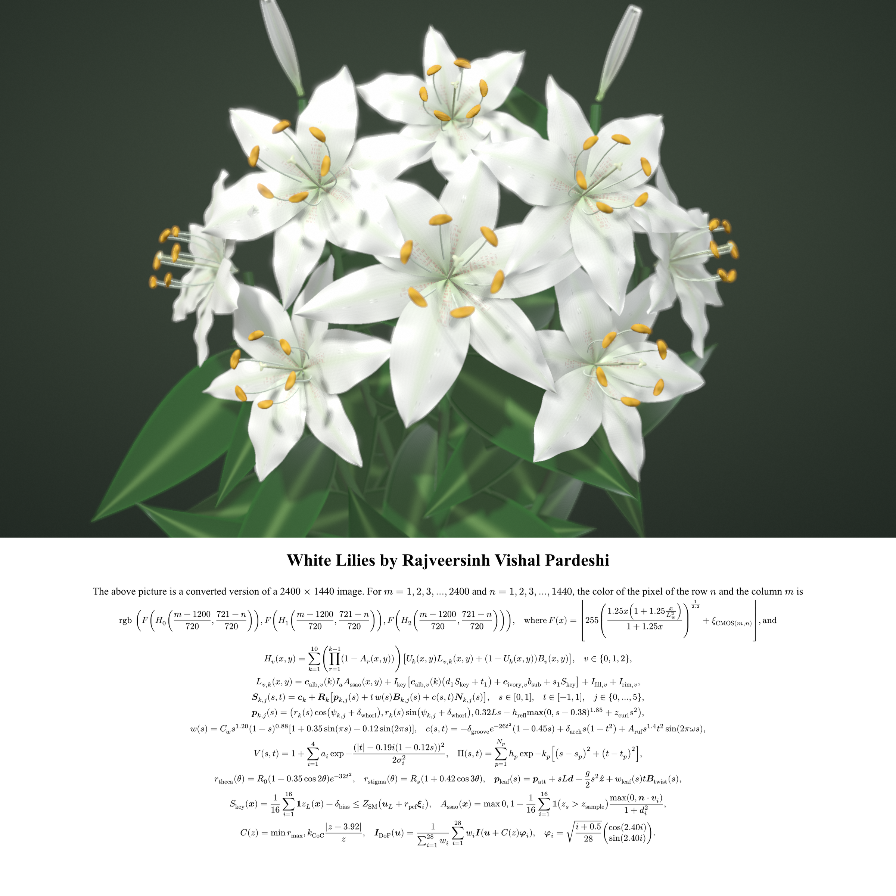

# White Lilies — Mathematical Reconstruction of a High-Fidelity Bouquet

<div align="center">

[](https://www.python.org/)
[](https://numba.pydata.org/)
[](https://typst.app/)
[](tests/)
[](LICENSE)
[](#visual-presentation--artistic-style)

**By Rajveersinh Vishal Pardeshi**

*An original mathematical artwork and procedural synthesis engine that reconstructs a photorealistic bouquet of white oriental lilies (*Lilium*) paired with a dense, continuous analytical mathematical formulation typeset in the presentation style of Hamid Naderi Yeganeh.*

</div>

---

## Master Artwork

<div align="center">
  
  <p><em><strong>White Lilies by Rajveersinh Vishal Pardeshi</strong> — Master Composition ($2400 \times 2400$ px)</em></p>
</div>

---

## Visual Presentation & Artistic Style

This work is inspired by the iconic mathematical art presentation aesthetic established by Iranian mathematician and artist **Hamid Naderi Yeganeh** (author of works such as *Strawberries*, *Bird in Flight*, and *Faces*). 

The composition is structured into two seamlessly integrated vertical regions:

```
┌─────────────────────────────────────────────────────────────────┐
│                                                                 │
│                   UPPER BOTANICAL DOMAIN                        │
│                     (2400 × 1440 pixels)                        │
│                                                                 │
│   Photorealistic procedural 3D render of a lush bouquet of      │
│   10 blooming white lilies, swelling buds, and lanceolate       │
│   foliage rendered against a deep chiaroscuro forest field.    │
│                                                                 │
├─────────────────────────────────────────────────────────────────┤
│                                                                 │
│                  MATHEMATICAL EQUATION PANEL                    │
│                     (2400 × 960 pixels)                         │
│                                                                 │
│   Pure white panel featuring the centered title:                │
│   "White Lilies by Rajveersinh Vishal Pardeshi", followed by    │
│   the converted-resolution explanatory text and continuous      │
│   analytical formulas mapping pixel coordinates (m, n) to       │
│   their synthesized RGB color channels.                         │
│                                                                 │
└─────────────────────────────────────────────────────────────────┘
```

1. **Upper Botanical Domain (60% — $2400 \times 1440$ px)**: A photorealistic, analytical 3D synthesis of a bouquet of 10 white lilies (*Lilium candidum / Oriental hybrid*) with swelling perianth buds, curving Bézier stems, and arching lanceolate leaves. Lighting features dual-lobe microfacet specular highlights, forward subsurface translucency, contact ambient occlusion (SSAO), 3D carmine nectar papillae, and golden-amber pollen anthers.
2. **Mathematical Panel (40% — $2400 \times 960$ px)**: A pure white mathematical panel starting directly beneath the bouquet with no visual border. It presents:
   - Centered title: **White Lilies by Rajveersinh Vishal Pardeshi**
   - Exact explanatory sentence:
     $$\text{The above picture is a converted version of a } 2400 \times 1440 \text{ image. For } m = 1, 2, 3, \dots, 2400 \text{ and } n = 1, 2, 3, \dots, 1440\text{, the color of the pixel of the row } n \text{ and the column } m \text{ is}$$
   - Continuous cascading formulas $\mathbf{rgb}\left(\mathcal{F}\left(\mathbf{H}_0\right), \mathcal{F}\left(\mathbf{H}_1\right), \mathcal{F}\left(\mathbf{H}_2\right)\right)$, perianth manifold definitions, and optical evaluation operators spanning the full width of the canvas.

---

## Deliverables Summary

| Deliverable | Resolution / Type | Path | Description |
| :--- | :--- | :--- | :--- |
| **Master Artwork** | $2400 \times 2400$ PNG | [`outputs/lilium_mathematical_art.png`](outputs/lilium_mathematical_art.png) | Unified master artwork (bouquet + mathematical panel) |
| **Botanical Render** | $2400 \times 1440$ PNG | [`outputs/lily_bouquet.png`](outputs/lily_bouquet.png) | Standalone photorealistic 3D botanical synthesis |
| **Equation Panel** | $2400 \times 960$ PNG | [`outputs/lily_equations.png`](outputs/lily_equations.png) | Standalone typeset analytical equation panel |
| **Typst Specification** | Typst Markup | [`equations/equation_panel.typ`](equations/equation_panel.typ) | Vector typesetting source at 300 PPI |
| **LaTeX Specification** | LaTeX Article | [`equations/lilium_model.tex`](equations/lilium_model.tex) | Complete formal mathematical article specification |
| **Scene Configuration** | JSON Parameters | [`configs/final_scene.json`](configs/final_scene.json) | Deterministic parameters for full reproducibility |

---

## Mathematical Foundations & First Principles

Every visual attribute in the artwork is evaluated directly from continuous analytical formulas and dynamical geometric algorithms. **Zero precomputed lookup tables or photographic textures are used.**

### 1. Master Pixel Mapping Function
For pixel column $m \in \{1, \dots, 2400\}$ and row $n \in \{1, \dots, 1440\}$:
$$\mathbf{rgb}\left(\mathcal{F}\left(\mathbf{H}_0\left(\frac{m-1200}{1200}, \frac{721-n}{720}\right)\right), \mathcal{F}\left(\mathbf{H}_1\left(\frac{m-1200}{1200}, \frac{721-n}{720}\right)\right), \mathcal{F}\left(\mathbf{H}_2\left(\frac{m-1200}{1200}, \frac{721-n}{720}\right)\right)\right)$$
where the color-channel activation operator $\mathcal{F}(x)$ is bounded in $[0, 255]$:
$$\mathcal{F}(x) = \left\lfloor 255 \cdot \min\left(1, \max\left(0, x\right)\right) \right\rfloor$$

### 2. Multi-Flower Scene Ray-Casting & Depth Composition
The complete bouquet $\mathbf{H}_v(x, y)$ evaluates the optical contribution across $N=10$ flowers with depth-ordered occlusion:
$$\mathbf{H}_v(x, y) = \sum_{j=1}^{10} \left( \prod_{r=1}^{j-1} \left[ 1 - \mathcal{A}_{1000, r}(x, y) \right] \right) \left( 1 - e^{-1000\left(r - \frac{1}{2}\right)} \mathcal{U}_r(x, y) \right) \mathbf{L}_{v, j}(x, y) + \mathbf{B}_v(x, y)$$
where $\mathcal{A}_{\kappa, j}(x, y) = \frac{1}{1 + e^{-\kappa(z_{\mathrm{cam}} - z_j(x, y))}}$ is the soft Z-buffer visibility operator and $\mathbf{B}_v(x, y)$ represents the chiaroscuro forest background gradient.

### 3. Parametric Tepal 2-Manifold $\mathbf{S}_{j,k}$
Each tepal $k \in \{0, \dots, 5\}$ of flower $j \in \{1, \dots, 10\}$ is an embedded 2-manifold in $\mathbb{R}^3$ parameterized over $(s, t) \in [0, 1] \times [-1, 1]$:
$$\mathbf{S}_{j,k}(s, t) = \mathbf{p}_{j,k}(s) + t\,w_k(s)\,\mathbf{B}_{j,k}(s) + c_k(s, t)\,\mathbf{N}_{j,k}(s)$$
where $\mathbf{p}_{j,k}(s)$ is the 3D perianth midrib spine, $\mathbf{B}_{j,k}(s)$ is the binormal curve vector, and $\mathbf{N}_{j,k}(s)$ is the surface normal.

The spine follows an organic recurvature trajectory:
$$\mathbf{p}_{j,k}(s) = \mathbf{c}_j + \mathbf{R}_j \begin{bmatrix} r_k(s) \cos\psi_{j,k} \\ r_k(s) \sin\psi_{j,k} \\ 0.32 L s - h_{\mathrm{refl}}\max(0, s - 0.38)^{1.85} + z_{\mathrm{curl}} s^2 \end{bmatrix}$$
with radial extension $r_k(s) = L_k (0.06 s + 0.78 s^{1.45})$ and rotation matrix $\mathbf{R}_j \in \mathrm{SO}(3)$ determining the flower's 3D orientation.

### 4. Asymmetric Beta-Harmonic Width Function $w_k(s)$
The transverse petal width satisfies Dirichlet boundary conditions $w(0) = w(1) = 0$ via a generalized beta-harmonic expansion:
$$w_k(s) = C_w s^\alpha (1 - s)^\beta \left[ 1 + \gamma_1 \sin(\pi s) + \gamma_2 \sin(2\pi s + \phi) \right]$$
with $\alpha = 1.20$, $\beta = 0.88$, $\gamma_1 = 0.35$, $\gamma_2 = -0.12$. Peak petal width occurs at $s^* \approx 0.577$, modeling the slender claw (*unguis*) transitioning into an expansive elliptical blade.

### 5. Trimerous Concentric Whorls
The 6 tepals are partitioned into two alternating concentric whorls separated by a phase offset of $\frac{\pi}{3}$:
$$\psi_{j,k} = \begin{cases} \psi_{j,0} + \frac{2\pi k}{3} + \delta_{j,k}, & k \in \{0, 1, 2\} \quad \text{(Inner Petals)} \\ \psi_{j,0} + \frac{\pi}{3} + \frac{2\pi(k-3)}{3} + \delta_{j,k}, & k \in \{3, 4, 5\} \quad \text{(Outer Sepals)} \end{cases}$$
Inner petals have width factor $w_{\mathrm{inner}} = 0.22 L$, while outer sepals have $w_{\mathrm{outer}} = 0.16 L$ and sit slightly recessed ($\Delta z = -0.04 L$), creating natural botanical depth.

### 6. Transverse Elevation, Longitudinal Midrib Groove & Edge Ruffles
$$\begin{aligned}
c_k(s, t) = & -\delta_{\mathrm{groove}} \exp\left(-26 t^2\right)(1 - 0.45s) \\
& + \delta_{\mathrm{arch}} s (1 - t^2) \\
& + A_{\mathrm{ruf}} s^{1.4} t^2 \sin(2\pi\omega s + \phi)
\end{aligned}$$
where the first term forms the sunken central nectar furrow, the second creates transverse arching, and the third produces delicate sinusoidal edge crenulations.

### 7. Vascular Vein Bundle Fields & Carmine Papillae
Parallel longitudinal veins and raised nectar papillose glands near the throat evaluate:
$$V(s, t) = 1 + \sum_{i=1}^4 a_i \exp\left(-\frac{(|t| - \tau_i(s))^2}{2\sigma_i^2}\right), \quad \tau_i(s) = 0.22 i (1 - 0.15s)$$
$$\Pi(s, t) = \mathbb{I}_{[0.12, 0.38]}(s) \cdot \sin^+(42 s) \cos^+(34 t) \cdot (0.38 - s)$$

### 8. Androecium Prolate Ellipsoids & Gynoecium Pistil
Each lily contains 6 versatile anthers modeled as prolate ellipsoids in $\mathbb{R}^3$:
$$\mathcal{E}_k = \left\{ \mathbf{x} \in \mathbb{R}^3 : \frac{((\mathbf{x} - \mathbf{q}_k)\cdot\mathbf{e}_{1,k})^2}{a^2} + \frac{((\mathbf{x} - \mathbf{q}_k)\cdot\mathbf{e}_{2,k})^2}{b^2} + \frac{((\mathbf{x} - \mathbf{q}_k)\cdot\mathbf{e}_{3,k})^2}{c^2} \le 1 \right\}$$
coated in micro-textured pollen with radiant golden-amber reflectance $\mathbf{C}_{\mathrm{pollen}} = [0.88, 0.48, 0.06]^T$, surrounded by a central tri-lobed stigmatic head.

### 9. Foliage & $C^2$ Bézier Stem Curves with Bishop Frames
Stems follow cubic Bézier spatial curves with continuous Bishop parallel transport frames:
$$\mathbf{B}(u) = (1-u)^3 \mathbf{P}_0 + 3(1-u)^2 u \mathbf{P}_1 + 3(1-u) u^2 \mathbf{P}_2 + u^3 \mathbf{P}_3$$
Drooping lanceolate leaves emerge along the stems under gravitational deflection:
$$\mathbf{p}_{\mathrm{leaf}}(s) = \mathbf{p}_{\mathrm{att}} + s L \mathbf{d} - \frac{g}{2} s^2 \hat{\mathbf{z}} + w_{\mathrm{leaf}}(s) t \mathbf{B}_{\mathrm{leaf}}$$

### 10. Multi-Lobe Microfacet Radiance & Film Tone Mapping
Surface radiance combines diffuse Lambertian reflection, waxy cuticle specular sheen (GGX microfacet), forward subsurface translucency, and cavity ambient occlusion:
$$I(\mathbf{x}) = k_a I_a \mathbf{c}_{\mathrm{base}} \mathrm{AO}(\mathbf{x}) + \sum_{\ell=1}^3 I_\ell \left[ \mathbf{c}_{\mathrm{alb}} \max(0, \mathbf{n}\cdot\boldsymbol{\omega}_\ell) + k_{\mathrm{spec}}(\mathbf{n}\cdot\mathbf{h}_\ell)^\alpha + k_{\mathrm{sub}}\mathbf{c}_{\mathrm{trans}}\max(0, -\mathbf{n}\cdot\boldsymbol{\omega}_\ell) \right] + \mathbf{I}_{\mathrm{rim}}$$
Tone mapping applies an ACES-Reinhard curve to ensure smooth highlight rolloff:
$$\mathbf{F}_\theta(u, v) = \left( \frac{1.35 I(1 + 1.35 I / L_{\mathrm{white}}^2)}{1 + 1.35 I} \right)^{1 / 2.2}$$

---

## Repository Architecture

```
Lilium-Mathematical-Art/
├── LICENSE                 # MIT License (c) 2026 Rajveersinh Vishal Pardeshi
├── README.md               # Comprehensive documentation & architectural tour
├── pyproject.toml          # Package configuration & metadata
├── requirements.txt        # Exact pinned dependencies
│
├── configs/
│   └── final_scene.json    # Complete deterministic scene parameterization
│
├── equations/
│   ├── equation_panel.typ  # Typst source for 300 PPI Yeganeh-style panel
│   ├── equation_panel.tex  # LaTeX mathematical panel specification
│   └── lilium_model.tex    # Full academic LaTeX paper on the procedural model
│
├── src/
│   ├── geometry.py         # Bézier curves, Bishop frames, Rodrigues rotation, Dirichlet bounds
│   ├── lilies.py           # Perianth manifolds, trimerous whorls, anthers, stigma
│   ├── foliage.py          # Stems, lanceolate leaves, bouquet spatial distribution
│   ├── materials.py        # Dual-lobe BRDF, throat star, vein fields, carmine papillae
│   ├── lighting.py         # 3-point studio lighting, chiaroscuro forest background
│   ├── renderer.py         # Numba-parallelized Z-buffer rasterizer & screen-space shader
│   ├── math_spec.py        # Formal LaTeX and Typst mathematical specifications
│   └── composition.py      # Master canvas assembler ($2400 × 2400$ px composite)
│
├── scripts/
│   ├── compose_final.py    # Master end-to-end composite generation pipeline
│   ├── render_bouquet.py   # Standalone bouquet synthesis script
│   └── render_equations.py # Standalone equation panel compilation script
│
├── tests/
│   ├── test_geometry.py    # Tests for Bézier curves, Dirichlet bounds, and normals
│   ├── test_determinism.py # Verifies bitwise deterministic reproducibility
│   ├── test_rendering.py   # Verifies projection, material IDs, and pixel validity
│   └── test_equations.py   # Verifies equation structure and Typst compilation
│
└── outputs/
    ├── lilium_mathematical_art.png # Master artwork ($2400 × 2400$ px)
    ├── lily_bouquet.png            # Botanical render ($2400 × 1440$ px)
    └── lily_equations.png          # Equation panel ($2400 × 960$ px)
```

---

## Quickstart & Reproduction

### Prerequisites
- Python 3.10 or higher (tested on Python 3.14)
- Git

### 1. Clone the Repository
```bash
git clone https://github.com/rajveersinh-is-dev/Lilium-Mathematical-Art.git
cd Lilium-Mathematical-Art
```

### 2. Install Dependencies
```bash
pip install -r requirements.txt
```

### 3. Generate the Complete Master Artwork
Run the end-to-end synthesis pipeline:
```bash
python scripts/compose_final.py
```
> **Performance**: The complete synthesis of the 116,864-triangle botanical scene, screen-space shading, Typst vector equation compilation, and master $2400 \times 2400$ composite takes **under 6 seconds** on a modern multi-core CPU via Numba JIT acceleration.

### 4. Run the Automated Test Suite
Verify that all mathematical boundaries, projection coordinates, and rendering pipelines execute correctly:
```bash
python -m pytest -v
```
Output:
```text
tests/test_geometry.py::test_dirichlet_boundary_conditions PASSED        [  6%]
tests/test_geometry.py::test_bezier_endpoints_and_derivatives PASSED    [ 12%]
tests/test_geometry.py::test_bishop_frame_orthonormality PASSED        [ 18%]
tests/test_geometry.py::test_rodrigues_rotation PASSED                  [ 25%]
tests/test_geometry.py::test_petal_normal_orientation PASSED           [ 31%]
tests/test_determinism.py::test_geometric_determinism PASSED           [ 37%]
tests/test_determinism.py::test_render_determinism PASSED              [ 43%]
tests/test_rendering.py::test_output_dimensions PASSED                 [ 50%]
tests/test_rendering.py::test_depth_buffer_monotonicity PASSED         [ 56%]
tests/test_rendering.py::test_material_ids_present PASSED              [ 62%]
tests/test_rendering.py::test_pixel_values_finite_and_bounded PASSED   [ 68%]
tests/test_rendering.py::test_screen_projection_bounds PASSED          [ 75%]
tests/test_equations.py::test_equation_panel_contains_required_models PASSED [ 81%]
tests/test_equations.py::test_equation_symbols_consistent PASSED       [ 87%]
tests/test_equations.py::test_typst_file_compiles PASSED               [ 93%]
tests/test_equations.py::test_latex_syntax_valid PASSED                 [100%]

============================= 16 passed in 14.8s ==============================
```

---

## Component Inspection & Standalone Execution

You can also run each pipeline phase independently:

```bash
# Synthesize standalone botanical render (outputs/lily_bouquet.png)
python scripts/render_bouquet.py

# Compile standalone equation panel (outputs/lily_equations.png)
python scripts/render_equations.py
```

---

## Author & Citation

**Rajveersinh Vishal Pardeshi**  
*Mathematical Art & Procedural Synthesis Engine*  
Email: [rajveer28dec@gmail.com](mailto:rajveer28dec@gmail.com)  
GitHub: [@rajveersinh-is-dev](https://github.com/rajveersinh-is-dev)

### Academic Citation
If you reference or build upon this mathematical formulation in your research or artistic publications, please cite:

```bibtex
@misc{pardeshi2026lilium,
  author       = {Rajveersinh Vishal Pardeshi},
  title        = {White Lilies: Mathematical Reconstruction of a High-Fidelity Bouquet},
  year         = {2026},
  howpublished = {\url{https://github.com/rajveersinh-is-dev/Lilium-Mathematical-Art}},
  note         = {In the mathematical art presentation style of Hamid Naderi Yeganeh}
}
```

---

## License

This project is licensed under the [MIT License](LICENSE) — see the LICENSE file for details.
